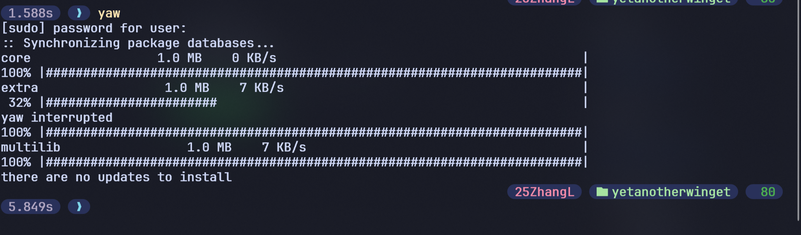

# yet-another-winget
## a yay like winget package manager without actual functions

# Functions:
- Simple [sudo] password manager
- Dynamic sync/download speed
- Progress bar clone (random plugin)
- CTRL-C cancel interruption

# Details:
- hidden password input (using getpass)
- Random download speeds
- Failed Sudo attempt waits for 1 second

# Bugs/needs to fix:
- Failed Sudo attempt loops into function
- Library info should be at left of progress bar
- inverted download speed display, larger numbers result slower speeds
- Threading for download progresss
